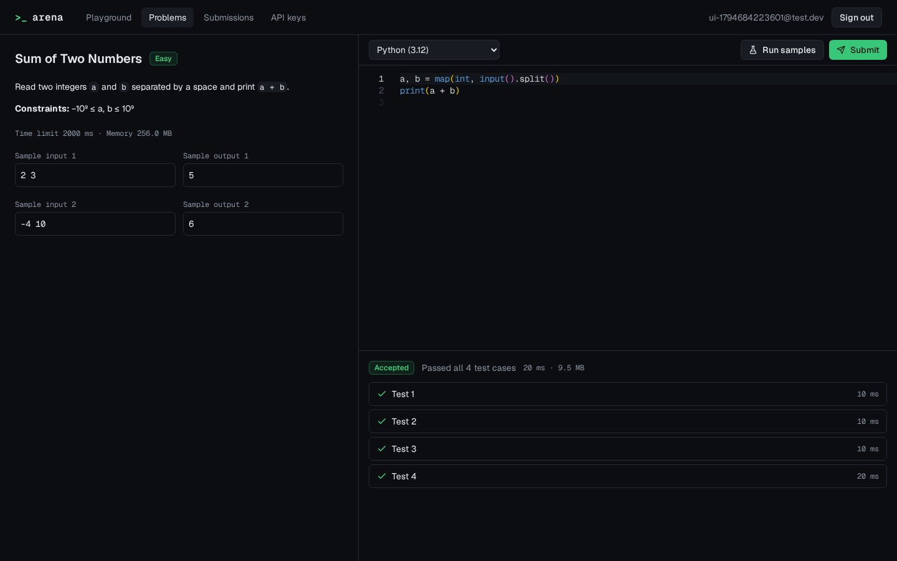

# Arena

A self-hosted remote code execution engine. Send code, it runs in an isolated
Docker container, and you get back the verdict, output, time and memory.

- **Judge0-compatible API**: point an existing Judge0 client at Arena and send an API key
- **Six languages**: C, C++, Java, JavaScript, Python, TypeScript
- **Hardened sandbox**: no network, read-only, non-root, no capabilities, CPU / memory / process / output limits
- **LeetCode-style judging**: test cases in one sandbox, stop at the first failure, hidden tests stay hidden
- **Live results** over Server-Sent Events
- **Web app**: Monaco playground, problems, submission history, API keys
- **Observability**: JSON logs, Prometheus metrics, alerts, a Grafana dashboard
- **One-command deploy** with Docker Compose and automatic HTTPS

Built chapter by chapter for the [@codebysuraj](https://youtube.com/@codebysuraj)
YouTube series. Reference: [CodeBox](https://github.com/hiteshchoudhary/Codebox) (MIT).



## Quick start (development)

Requirements: Node 22+, pnpm 10, Docker.

```bash
cp .env.example .env              # set BETTER_AUTH_SECRET: openssl rand -base64 32
docker compose up -d              # Postgres + Redis
pnpm install
pnpm images:build                 # sandbox images (one-time, a few minutes)
pnpm db:migrate && pnpm db:seed
pnpm dev                          # web :3000, API :4000, worker
```

Open http://localhost:3000, sign up, and try the Playground.

## Production

```bash
./scripts/setup-production.sh arena.example.com
```

See [docs/DEPLOYMENT.md](docs/DEPLOYMENT.md) for requirements, scaling, security and backups.

## Use the API

Create a key under **API keys** in the web app, then:

```bash
curl -X POST "https://api.arena.example.com/submissions?wait=true" \
  -H "X-Auth-Token: $ARENA_KEY" -H "Content-Type: application/json" \
  -d '{"source_code":"print(input()[::-1])","language_id":71,"stdin":"arena"}'
# {"stdout":"anera\n","time":"0.010","memory":9580,"status":{"id":3,"description":"Accepted"},…}
```

| Endpoint                                                    | Purpose                  |
| ----------------------------------------------------------- | ------------------------ |
| `POST /submissions` (`wait`, `base64_encoded`, `fields`)    | Judge0: run code         |
| `GET /submissions/:token`                                   | Judge0: read a result    |
| `POST /submissions/batch`, `GET /submissions/batch?tokens=` | Judge0: up to 20 at once |
| `GET /languages`, `/statuses`, `/about`                     | Judge0: metadata         |
| `POST /v1/run`, `/v1/submissions`                           | Arena API (signed in)    |
| `GET /v1/problems`, `POST /v1/problems/:slug/submit`        | Problems                 |
| `GET /v1/submissions/:token/events`                         | Live events (SSE)        |
| `GET /health`, `/ready`, `/metrics`                         | Operations               |

## Scripts

| Command                                        | What it does                                               |
| ---------------------------------------------- | ---------------------------------------------------------- |
| `pnpm dev`                                     | Web, API and worker in watch mode                          |
| `pnpm test`                                    | Unit and integration tests (Postgres + Redis needed)       |
| `pnpm test:docker`                             | Executor and sandbox attack tests (Docker + images)        |
| `pnpm e2e`                                     | Browser flows against a running app (`WEB_URL`, `API_URL`) |
| `pnpm load-test`                               | End-to-end load test (`API_URL`, `ARENA_KEY`)              |
| `pnpm lint` / `typecheck` / `build` / `format` | The usual                                                  |
| `pnpm images:build`                            | Sandbox runtime images                                     |
| `pnpm smoke`                                   | Start the built API and check `/health`                    |

## Architecture

[docs/ARCHITECTURE.md](docs/ARCHITECTURE.md) has the system diagram and the
life of a submission. Each chapter has its own docs in
[docs/chapters/](docs/chapters/) and the plan is in [docs/CHAPTERS.md](docs/CHAPTERS.md).

```
apps/       api · worker · web
packages/   shared · db · engine · queue · telemetry · tsconfig
docker/     runtimes/ (sandbox images) · Dockerfile (production images)
ops/        caddy · prometheus · grafana
tests/      e2e (Playwright) · load
```

## Stack

TypeScript · Turborepo + pnpm · Hono · Better Auth · Drizzle + Postgres ·
BullMQ + Redis · dockerode · Next.js 16 + Tailwind 4 · Monaco · pino ·
Prometheus · Grafana · Caddy.
