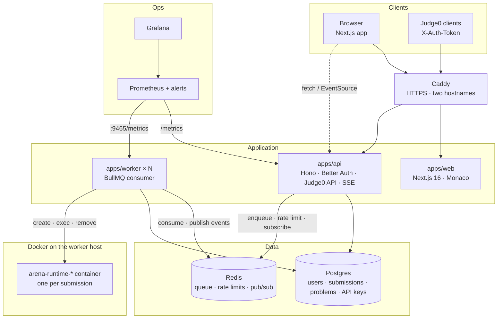
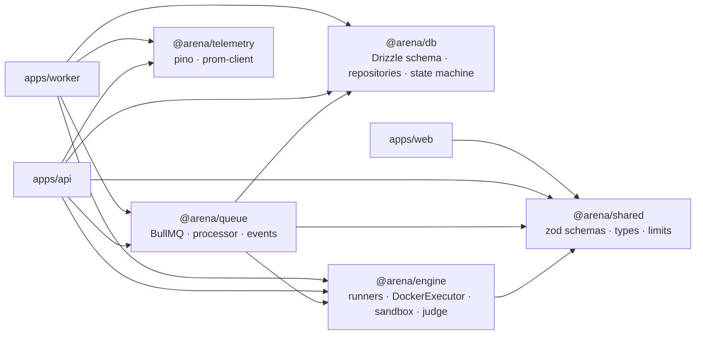

# Arena architecture

## Packages

## Life of a submission

1. **Create.** The API validates the body (zod), checks the language, writes a
   `submissions` row (`in_queue`) and adds a BullMQ job whose ID is the
   submission ID.
2. **Claim.** A worker takes the job and moves the row to `processing` with a
   conditional update, so no submission runs twice.
3. **Execute.** `DockerExecutor` starts a locked-down container, writes the
   source, compiles once, lowers the memory cap, runs each input with
   `docker exec` under `timeout` and GNU `time`, and removes the container.
4. **Judge.** `classifyRun` turns exit code, signal, time and memory into a run
   status; `judgeTests` compares outputs and stops at the first failure.
5. **Save and notify.** The verdict is saved (only from `processing`), per-test
   results are stored, and `status`/`test`/`done` events go out over Redis
   pub/sub to every API instance and on to browsers over SSE.

## Key decisions

| Decision                                      | Why                                                         |
| --------------------------------------------- | ----------------------------------------------------------- |
| Postgres is the source of truth               | Redis only carries IDs and events; losing it loses no data  |
| One container per submission, `exec` per test | Compile once; isolation between submissions                 |
| GNU `time` in every image                     | Same memory measurement on cgroup v1 and v2 hosts           |
| Judge0 language IDs and status table          | Existing Judge0 clients work unchanged                      |
| SSE + Redis pub/sub                           | One-way updates over plain HTTP, fan-out to every API       |
| Two hostnames                                 | Judge0's `/submissions` would clash with the web page       |
| Everything injected (`createApp(deps)`)       | Tests swap Docker, Redis and Prometheus for in-memory fakes |

Per-chapter details: [docs/chapters/](chapters/).
