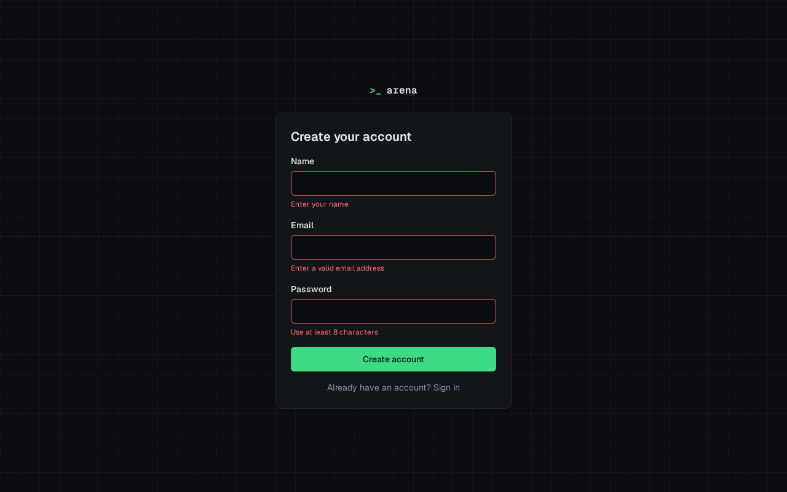
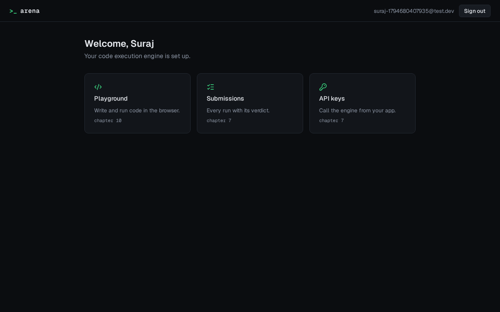

# Chapter 1: Project init and authentication setup

**Goal:** a working monorepo where a user can sign up, sign in, see a protected
dashboard and sign out, with every check (format, lint, typecheck, tests,
build) running locally and in CI.

## What you get

- Turborepo + pnpm monorepo: `apps/api`, `apps/web`, `packages/shared`, `packages/tsconfig`
- Hono API on Node 22 with `/health`, Better Auth at `/api/auth/*` and `GET /v1/me`
- Email and password auth (Better Auth on Postgres), 7-day sessions in an HTTP-only cookie
- Shared zod schemas used by both the sign-up form and the tests
- `AppError` base class: every error is JSON, internals never leak
- Next.js 16 web app: sign-up, sign-in, protected dashboard, sign-out
- `proxy.ts` that redirects signed-out visitors to `/sign-in`
- Dark design system: tokens in `globals.css`, Button, Input, Label, Card, Geist fonts
- GitHub Actions CI with a Postgres service




## Run it

```bash
cp .env.example .env          # then set BETTER_AUTH_SECRET (openssl rand -base64 32)
docker compose up -d          # Postgres + Redis
pnpm install
pnpm db:migrate               # Better Auth tables
pnpm dev                      # API on :4000, web on :3000
```

Open http://localhost:3000. You land on `/sign-in`.

## Files to read first

| File                                         | Why                                         |
| -------------------------------------------- | ------------------------------------------- |
| `apps/api/src/app.ts`                        | All middleware and routes in one place      |
| `apps/api/src/auth.ts`                       | Better Auth configuration                   |
| `apps/api/src/lib/errors.ts`                 | `AppError` hierarchy                        |
| `packages/shared/src/auth.ts`                | The zod schemas shared by client and server |
| `apps/web/src/components/auth/auth-form.tsx` | One form for both sign-in and sign-up       |
| `apps/web/src/proxy.ts`                      | Redirects based on the session cookie       |

## More docs

[IMPLEMENTATION](IMPLEMENTATION.md) · [ARCHITECTURE](ARCHITECTURE.md) ·
[TESTING](TESTING.md) · [PR_REVIEW](PR_REVIEW.md) · [REBUILD_PROMPT](REBUILD_PROMPT.md)

**Next:** Chapter 2, database and ORM layer setup (Drizzle replaces the Better
Auth migration script).
