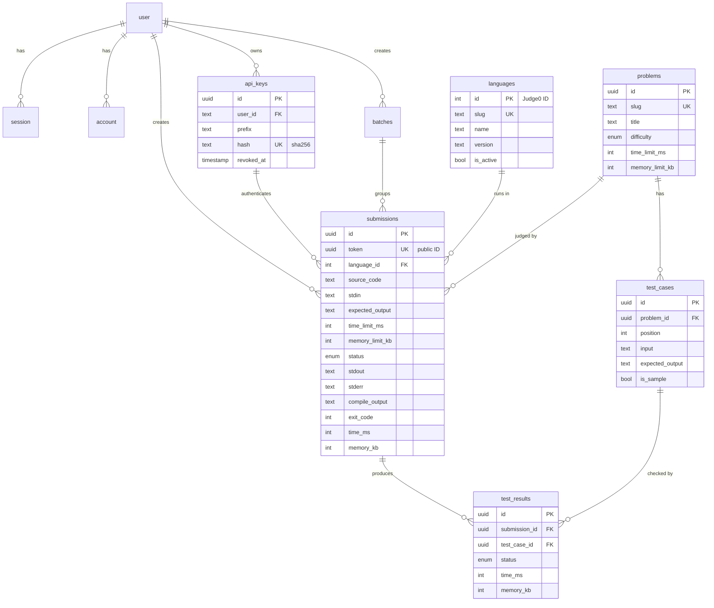

# Data model (Chapter 2)

`submission_status`: in_queue, processing, accepted, wrong_answer,
time_limit_exceeded, memory_limit_exceeded, output_limit_exceeded,
compilation_error, runtime_error, internal_error.
