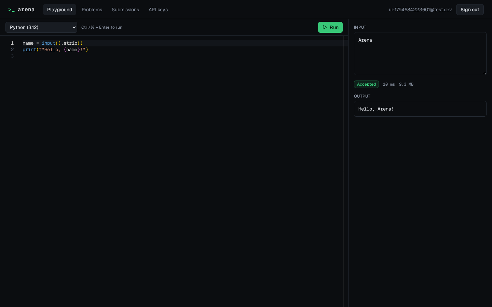
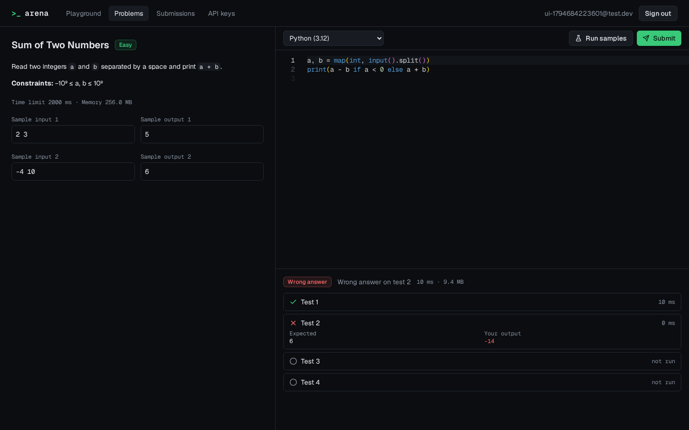
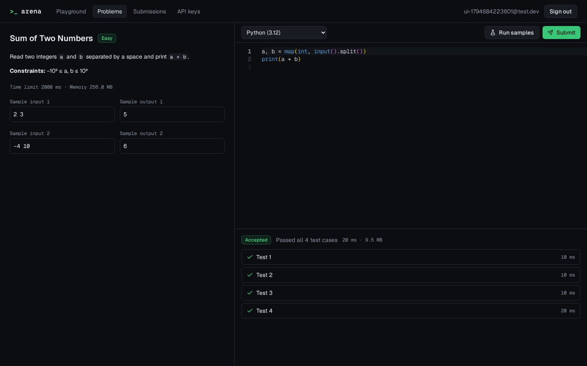

# Chapter 10: Monaco playground and problems UI

**Goal:** everything the engine can do, usable from the browser: write code,
run it, solve problems while watching tests pass live, look back at history,
and create API keys.

## What you get

- App shell with navigation and a session guard for every signed-in page
- **Playground**: Monaco editor, six languages with starter programs, stdin,
  Run (or Ctrl/⌘ + Enter), verdict, time, memory, output, errors, compiler output;
  drafts per language kept in the browser
- **Problems**: list with difficulty, statement with samples, Run samples / Submit,
  live per-test ticks over SSE, expected vs your output for failed samples
- **Submissions**: history table and a detail page with code and tests
- **API keys**: create (shown once, copy button), list with last use, revoke
- Monaco served from `public/monaco` (no CDN), with an Arena dark theme
- Typed API client (`lib/api.ts`) and `useSubmissionStream()` hook
- API: `?wait=false` on `/v1/run` and problem submit





## Run it

```bash
pnpm dev     # copies Monaco into public/ on first run
```

Open http://localhost:3000.

[IMPLEMENTATION](IMPLEMENTATION.md) · [ARCHITECTURE](ARCHITECTURE.md) ·
[TESTING](TESTING.md) · [PR_REVIEW](PR_REVIEW.md) · [REBUILD_PROMPT](REBUILD_PROMPT.md)

**Next:** Chapter 11, observability.
