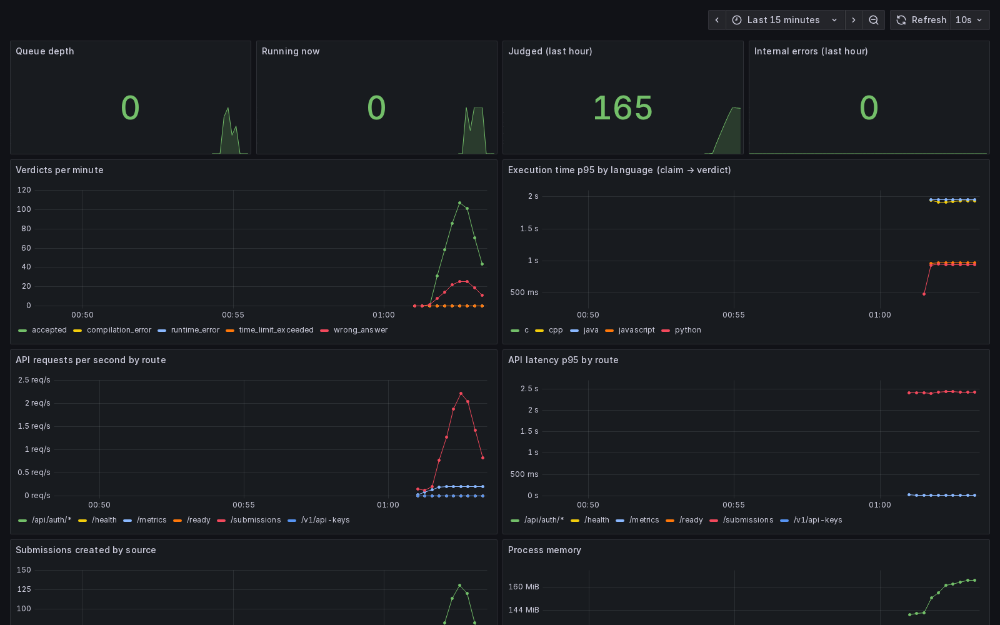

# Chapter 11: Observability

**Goal:** know what the engine is doing without reading code: how many
submissions are waiting, how long each language takes, what is failing, and
get told when something breaks.

## What you get

- `packages/telemetry`: pino logger, Prometheus registries, API and worker metrics, ops server
- JSON logs everywhere (no `console.*`), secrets redacted, one line per request with `requestId`
- `X-Request-Id` kept from the client or generated, returned on every response
- HTTP metrics labelled by **route pattern** (`/submissions/:token`), not raw URL
- Submissions created by language and source (web, judge0, problem); queue depth
- Worker: verdicts by language and status, claim-to-verdict duration, running jobs, failures
- `GET /metrics` (optional `METRICS_TOKEN`), `GET /ready` (database + Redis)
- Worker ops server on `:9465`: `/metrics` and `/health` (Redis + Docker)
- Prometheus config + 5 alert rules; Grafana datasource and "Arena overview" dashboard, provisioned
- `docker-compose.observability.yml` for local Prometheus (9090) and Grafana (3001)



## Run it

```bash
pnpm dev
docker compose -f docker-compose.observability.yml up -d
open http://localhost:3001     # Grafana, dashboard "Arena overview"
```

Edit panels in `ops/grafana/build-dashboard.mjs`, then `node ops/grafana/build-dashboard.mjs`.

[IMPLEMENTATION](IMPLEMENTATION.md) · [ARCHITECTURE](ARCHITECTURE.md) ·
[TESTING](TESTING.md) · [PR_REVIEW](PR_REVIEW.md) · [REBUILD_PROMPT](REBUILD_PROMPT.md)

**Next:** Chapter 12, deployment, load testing and final setup.
