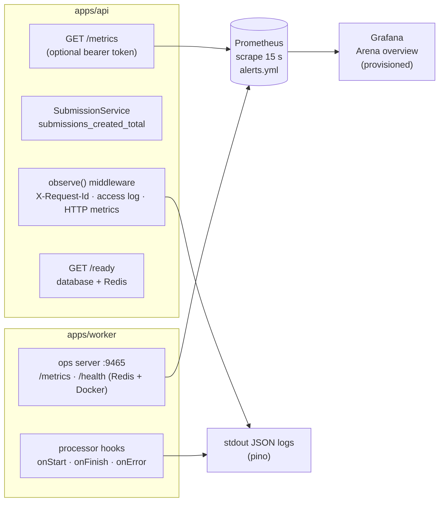

# Observability (Chapter 11)

## Metrics

| Metric                                | Type      | Labels                | From   |
| ------------------------------------- | --------- | --------------------- | ------ |
| `arena_http_requests_total`           | counter   | method, route, status | API    |
| `arena_http_request_duration_seconds` | histogram | method, route         | API    |
| `arena_submissions_created_total`     | counter   | language, source      | API    |
| `arena_queue_depth`                   | gauge     | –                     | API    |
| `arena_submissions_processed_total`   | counter   | language, status      | worker |
| `arena_execution_duration_seconds`    | histogram | language              | worker |
| `arena_active_executions`             | gauge     | –                     | worker |
| `arena_execution_failures_total`      | counter   | final                 | worker |
| `arena_process_*`, `arena_nodejs_*`   | default   | service               | both   |
